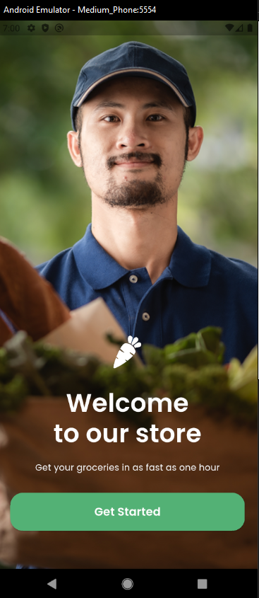
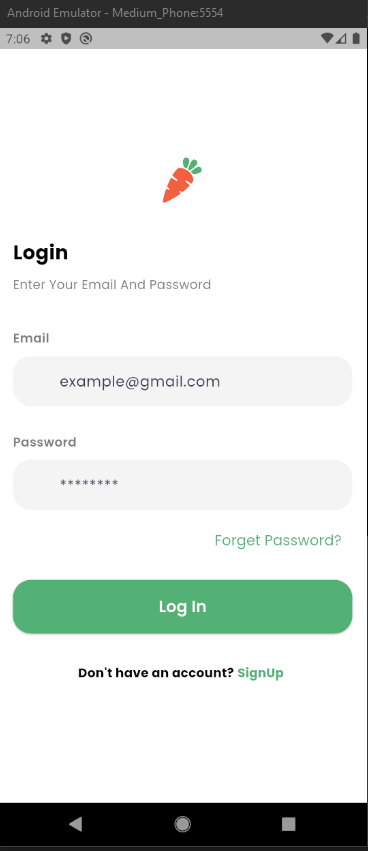
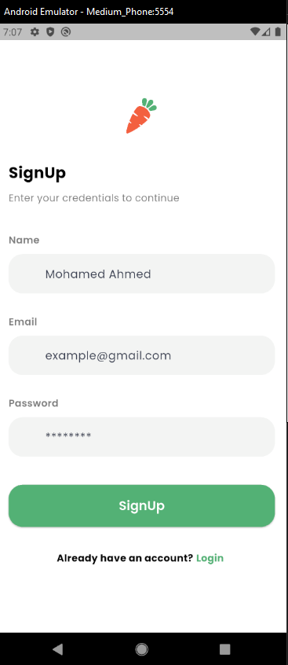
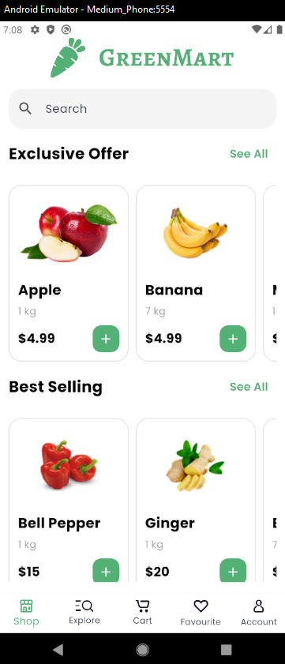
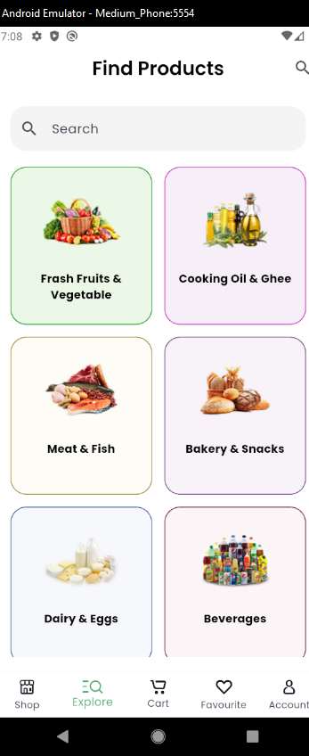
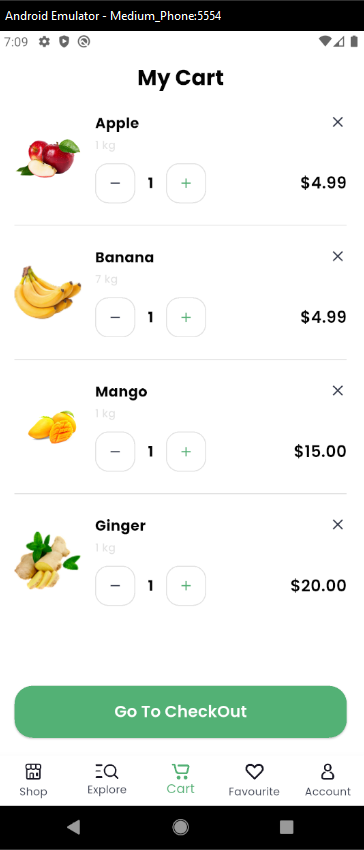
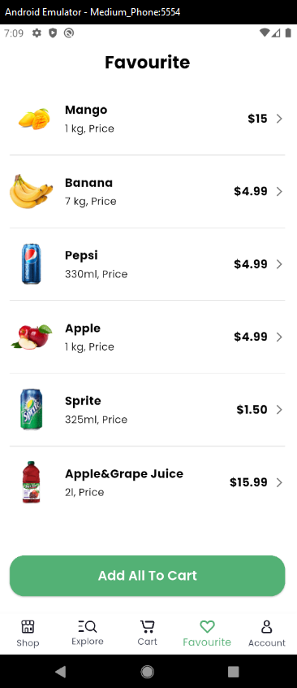
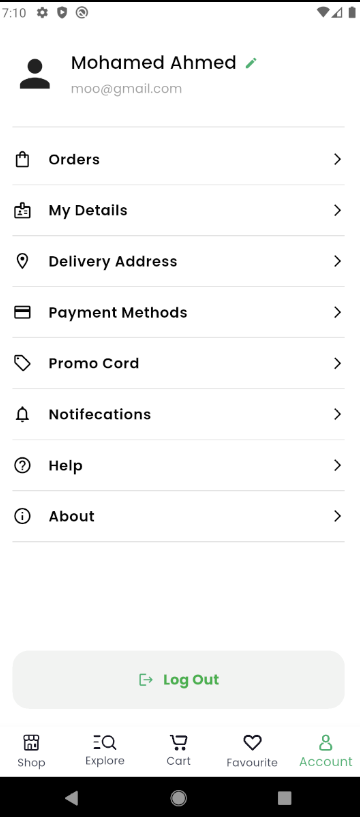

# GreenMart

GreenMart is a grocery-shopping mobile app built with Flutter. Browse grocery categories and products, and explore the shop, cart, favourites, and account screens in a clean, green-themed interface.

> Created as a team project during the DEPI program (Food-App-DEPI).

## Features

- Welcome, login, and sign-up screens
- Shop screen with product sections and add-to-cart controls
- Explore screen with grocery categories
- Cart screen with quantity controls and a checkout sheet
- Favourites screen with an add-all-to-cart action
- Account screen with profile and account menu options
- Bottom navigation for Shop, Explore, Cart, Favourite, and Account
- Product images, SVG icons, and Poppins fonts

The app currently uses local sample product data. Login and sign-up are interface flows; no authentication backend is configured.

## Screenshots

| Welcome | Login | Sign Up |
|:---:|:---:|:---:|
|  |  |  |

| Shop | Explore | Cart |
|:---:|:---:|:---:|
|  |  |  |

| Favourite | Account |
|:---:|:---:|
|  |  |

## Tech stack

- Flutter and Dart
- `flutter_svg` for SVG assets
- `gap` for layout spacing
- Poppins font family

## Getting started

### Prerequisites

- Flutter SDK installed and available on your `PATH`
- An Android emulator, iOS simulator, or connected device

### Run the app

```bash
flutter pub get
flutter run
```

## Project structure

```text
assets/
  fonts/
  icons/
  images/
lib/
  constants/
  features/
  functions/
  utiles/
  widgets/
screenshots/
```
